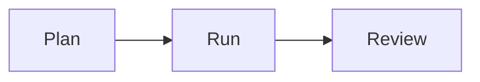

# Next Big Thing checklist

Use this list to check one campaign cycle from planning through review.

## Before you start

- [ ] Confirm the client can serve the people the campaign may reach.
- [ ] Review prior themes and choose a different theme for this cycle.
- [ ] Confirm the theme is seasonal or comes from one part of the main product or service.
- [ ] Agree with the client on the goal and measures.
- [ ] Let the client choose timing, price, channels, event format, and targets.

## Steps

- [ ] Split the audience into past buyers and warm leads.
- [ ] Plan to contact past buyers first and warm leads second.
- [ ] Get approval for the offer, event plan, audience, and messages.
- [ ] Run the [campaign setup SOP](../sops/next-big-thing-campaign.md) before invites go out.
- [ ] Send invites in the approved order.
- [ ] Deliver the offer or event as planned.
- [ ] Follow up with both audience groups.
- [ ] Record results and feedback by group.
- [ ] Review what you learned with the client.
- [ ] Record this theme so a later cycle can use a distinct one.

## Done when

- [ ] The campaign was checked and approved before invites went out.
- [ ] Delivery and follow-up are complete, or open items have an owner.
- [ ] The client has reviewed the chosen measures and the results.
- [ ] The theme and learning are saved for the next planning cycle.

This diagram shows the three parts of one cycle.

