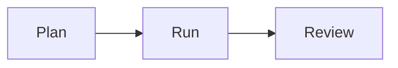

# Next Big Thing checklist

Use this list to check one campaign cycle from planning through review.

## Before you start

- [ ] Confirm you can serve the people the campaign may reach.
- [ ] Review past themes and choose a different theme for this run.
- [ ] Confirm the theme is seasonal or comes from one part of your main product or service.
- [ ] Choose the learning goal and measures with us using [Choose the learning goal and measures](../playbooks/learning-goal-and-measures.md).
- [ ] Choose timing, price, channels, event format, and targets with us.

## Steps

- [ ] Split the audience into past buyers and warm leads.
- [ ] Plan to contact past buyers first and warm leads second.
- [ ] Choose the offer, event plan, audience, and messages with us.
- [ ] Run the [campaign setup SOP](../sops/next-big-thing-campaign.md) before invites go out.
- [ ] Approve the campaign plan before we send invites.
- [ ] We send invites in the planned order.
- [ ] We deliver the offer or event as planned.
- [ ] We follow up with both audience groups.
- [ ] We record results and feedback by group.
- [ ] Review what you learned with us.
- [ ] We record this theme so a later run can use a different one.

## Done when

- [ ] We checked the campaign and you approved it before invites went out.
- [ ] Delivery and follow-up are complete, or open items have an owner.
- [ ] You reviewed the chosen measures and results with us.
- [ ] The theme and learning are saved for the next planning cycle.

This diagram shows the three parts of one cycle.

