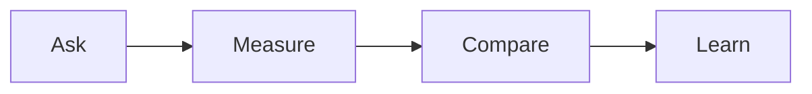

# Choose the learning goal and measures

Use this guide before you run a Next Big Thing campaign. It helps you learn
from a test. It does not promise a sale.

This diagram shows the path from a question to a next step.

## 1. Name one question

Write one important question the campaign should answer. Keep it about a choice
you may need to make.

For example: “Will past buyers want this workshop about planning for the busy
season?” A question about interest is useful even if it does not lead to a sale.

Avoid joining several questions. Pick the one that matters most for this run.

## 2. Set a learning goal

Turn your question into a clear goal. Say what you hope to learn, from whom,
and what choice the answer may help you make.

A learning goal is not a sales promise. “Learn whether past buyers show enough
interest to plan another workshop” is a learning goal. “Sell a set amount” is
not a learning goal.

Choose a result you can observe. Do not set a fixed target just because another
campaign used it. The right result depends on your audience, offer, and what
you can deliver.

## 3. Choose a few measures

Start with past buyers. They are the first group you contact. Choose measures
that help answer your question. Then choose measures for warm leads, who have
shown interest but have not bought.

Use only a few measures that help you decide. Depending on the question, you
might count replies, sign-ups, attendance, requests for more detail, purchases,
or what people say in feedback. Do not count a measure just because it is easy
to find.

Keep each group separate. A combined total can hide a difference between past
buyers and warm leads.

## 4. Define each measure

Before invites go out, agree on these details for every measure:

- **Meaning:** What counts? For example, does a sign-up mean a completed form?
- **Source:** Where will the number or note come from, such as a form, event
  list, sales record, or feedback note?
- **When to count:** Which campaign step or event marks the count? Choose a
  point that fits your campaign. Do not assume every run uses the same time.
- **Comparison:** What will you compare? You might compare past buyers with
  warm leads, or this run with a similar past run. Check that the groups,
  offer, and counting rules are close enough to make the comparison useful.

If you cannot get a measure or make a fair comparison, write that down. Do not
fill a gap with a guess.

## 5. Agree what would change the next action

Before the campaign, write what you would do for different results. For
example, strong interest from past buyers may support planning the offer again.
Little interest may lead you to ask what did not fit, or choose a different
theme. A result that is hard to read may mean you test a clearer message or
collect better information.

Choose the signs that matter for your question. Do not use a universal target
or treat one result as proof that the next run will work. The result guides a
choice; it does not guarantee an outcome.

## 6. Record limits and learning

After follow-up, record the measures for each group and what they show. Also
record limits and unknowns. These may include missing replies, a small group,
changed messages, or a measure you could not collect.

Then write:

- What did you learn about your question?
- What is still unknown?
- What will you do next, and why?

Keep the record with your campaign notes. It can help you choose a distinct
theme for a later run. One run is a clue, not a promise about future results.

For the full campaign cycle, see the [Next Big Thing playbook](next-big-thing.md).
Use the [Next Big Thing checklist](../checklists/next-big-thing.md) to check
your run, and the [Next Big Thing campaign setup SOP](../sops/next-big-thing-campaign.md)
to prepare and test it.
