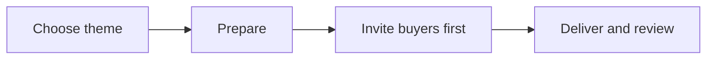

# Next Big Thing playbook

Use this playbook to plan, run, and review a campaign around one clear theme.

## Goal

Test whether one seasonal theme or one part of your main product or service is useful to past buyers and warm leads. A warm lead is someone who has shown interest but has not bought. We measure interest and repeat purchase as hypotheses, not promised results.

## When to use

Use this when you have a suitable theme and can serve the people it may reach. We contact past buyers first, then warm leads. For every later run, choose a different theme. The theme may be seasonal or come from one part of your main product or service.

## Roles

- **You:** choose the theme and make the final choices about the offer, event, audience, messages, and campaign details.
- **We:** help shape the plan, prepare and test the campaign, and support delivery and review.
- **Our support team:** handles questions and records issues, if needed.

## Inputs

- Your main product or service and the themes from past runs.
- A suitable theme and a clear audience need.
- Your choices for the offer, event, audience groups, and campaign messages.
- Choices you make with us for timing, price, channels, event format, and measures.

## Steps

1. Check that the theme fits your business and that you can serve the people it may attract.
2. Review past runs with us. Rule out any theme that repeats the same idea.
3. Choose one theme with us. State what you want to learn using [Choose the learning goal and measures](learning-goal-and-measures.md).
4. Split the audience into past buyers and warm leads. We plan to reach past buyers first.
5. Choose the offer and event with us, if an event fits.
6. We prepare the campaign and test it with the [campaign setup SOP](../sops/next-big-thing-campaign.md).
7. We invite past buyers first, then warm leads, using the plan you approved.
8. We deliver the offer or event with you and follow up with each group as planned.
9. Review the measures with us. We save what we learned and note a different theme for a later run.

This diagram shows how each cycle moves from a theme to a review.

## Gate

You approve the audience groups, offer, event plan, messages, timing, channels, and readiness test before we send invites. Confirm that past buyers come first and that the theme differs from past runs.

## Metrics

Choose measures with us using [Choose the learning goal and measures](learning-goal-and-measures.md). Possible measures include replies, sign-ups, attendance, sales, repeat purchases, and feedback. Compare results by audience group. One result does not prove that future themes will work.

## Outputs

- Campaign plan and readiness check approved by you.
- Delivery and follow-up record.
- Review of results and learning.
- A record of past themes to guide a different later run.

## Common failures

- **Same theme again:** compare the idea, not just its name, with past runs.
- **Past buyers are missed:** plan their invite before warm-lead outreach.
- **The plan assumes a sale:** set learning goals and measures, not promises.
- **Details are chosen too soon:** choose timing, price, channels, event format, and targets with us for each run.
- **No follow-up or review:** set an owner and plan both with us.

## Related

- Checklist: [Next Big Thing checklist](../checklists/next-big-thing.md)
- SOP: [Next Big Thing campaign setup SOP](../sops/next-big-thing-campaign.md)
