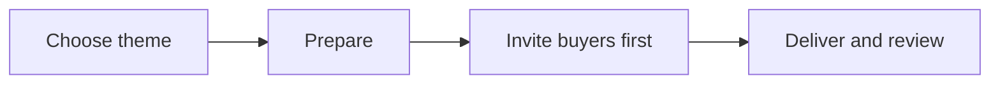

# Next Big Thing playbook

Use this playbook to plan, run, and review a campaign around one clear theme.

## Goal

Test whether one seasonal theme or one part of a client's main product or service is useful to past buyers and warm leads. A warm lead is someone who has shown interest but has not bought. Treat interest and repeat purchase as things to measure, not promised results.

## When to use

Use this when the client has a suitable theme and a clear reason to contact past buyers. Contact past buyers first, then warm leads. For each later cycle, choose a different theme. It may be seasonal or come from a different part of the client's main product or service.

## Roles

- **Delivery lead:** agrees on the goal and client choices.
- **Campaign operator:** prepares and checks the campaign.
- **Client owner:** approves the theme, offer, event, audience, and messages.
- **Support lead:** handles questions and records issues, if needed.

## Inputs

- Client's main product or service and prior campaign themes.
- A suitable theme and a clear audience need.
- Approved offer, event plan, audience groups, and campaign messages.
- Client choices for timing, price, channels, event format, and measures.

## Steps

1. Check that the client has a useful theme and can serve the people it attracts.
2. Review prior cycles. Rule out a theme that repeats the same idea.
3. Choose one theme with the client. State what you want to learn.
4. Split the audience into past buyers and warm leads. Plan to reach past buyers first.
5. Agree on the offer and event, if an event fits. Let the client choose the details.
6. Prepare the campaign and use the [campaign setup SOP](../sops/next-big-thing-campaign.md) to test it.
7. Invite past buyers first. Invite warm leads second, using the client-approved plan.
8. Deliver the offer or event. Follow up with each group in the agreed way.
9. Review the measures with the client. Save what you learned and note a distinct theme for a later cycle.

This diagram shows how each cycle moves from a theme to a review.

## Gate

Do not send invites until the client approves the audience groups, offer, event plan, messages, timing, channels, and readiness test. Confirm that past buyers come first and that the theme differs from prior cycles.

## Metrics

Choose measures with the client. Possible measures include replies, sign-ups, attendance, sales, repeat purchases, and feedback. Compare results by audience group. Do not treat one result as proof that all future themes will work.

## Outputs

- Approved campaign plan and readiness check.
- Delivery and follow-up record.
- Review of results and learning.
- A note of prior themes to guide a distinct later cycle.

## Common failures

- **Same theme again:** compare the idea, not just its name, with past cycles.
- **Past buyers are missed:** plan their invite before warm-lead outreach.
- **The plan assumes a sale:** set learning goals and measures, not promises.
- **Details are chosen too soon:** leave timing, price, channels, event format, and targets to the client.
- **No follow-up or review:** name an owner and schedule both with the client.

## Related

- Checklist: [Next Big Thing checklist](../checklists/next-big-thing.md)
- SOP: [Next Big Thing campaign setup SOP](../sops/next-big-thing-campaign.md)
