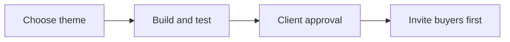

# Next Big Thing campaign setup SOP

Use this procedure to prepare and test a campaign before sending invites.

## Trigger

Start when the client approves exploring a theme for a campaign.

## Roles

- **Campaign operator:** builds and tests the campaign.
- **Client owner:** chooses and approves campaign details.
- **Delivery lead:** checks the plan and resolves open choices.

## Procedure

1. Review the client's main product or service and the themes used in prior cycles.
2. Ask the client to choose one distinct theme. It may be seasonal or from one part of the main product or service.
3. Write the learning goal and the measures the client will use.
4. Split the audience into past buyers and warm leads. Check that the plan contacts past buyers first.
5. Ask the client to choose timing, price, channels, event format, and targets.
6. Prepare the offer, event plan if used, audience lists, and messages for client review.
7. Test each link, form, sign-up path, message, and follow-up step that applies.
8. Check that the offer and delivery plan match what the client can provide.
9. Review the full plan with the client. Record approval and any limits.
10. Release invites only after all required checks pass. Contact past buyers first, then warm leads as approved.

This diagram shows the path from a theme to approved invites.

## Decision points

- If the theme repeats the same idea as a prior cycle, stop and choose another.
- If there is no clear audience need or the client cannot serve the audience, pause and review fit with the delivery lead.
- If a detail is not chosen, ask the client. Do not set timing, price, channels, event format, or targets for them.
- If a test fails, fix it and test again. Do not send invites with a broken path.
- If the client has not approved the plan, hold the campaign.

## Escalation

Tell the delivery lead about unclear fit, a repeated theme, missing client choices, failed tests, or a delivery risk. Ask the client owner to resolve choices that belong to the client. Keep invites on hold until the issue is resolved.

## Records

Save the approved theme, audience groups and order, client choices, final messages, test results, approval, and any open issues in the client's campaign record. After delivery, add the agreed measures and review notes.
