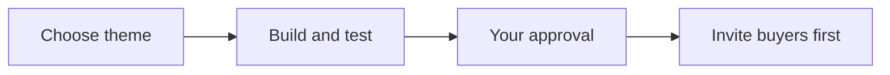

# Next Big Thing campaign setup SOP

Use this procedure to prepare and test a campaign before sending invites.

## Trigger

Start when you decide to explore a theme for a campaign with us.

## Roles

- **You:** choose the campaign details and approve the plan before invites go out.
- **We:** prepare and test the campaign, check the plan, and resolve open items with you.

## Procedure

1. Review your main product or service and the themes from past runs with us.
2. Choose one different theme with us. It may be seasonal or from one part of your main product or service.
3. Set the learning goal and choose measures with us using [Choose the learning goal and measures](../playbooks/learning-goal-and-measures.md).
4. Split the audience into past buyers and warm leads. Plan to contact past buyers first.
5. Choose timing, price, channels, event format, and targets with us.
6. We prepare the offer, event plan if used, audience lists, and messages for your review.
7. We test each link, form, sign-up path, message, and follow-up step that applies.
8. Check with us that the offer and delivery plan match what you can provide.
9. Review the full plan with us. You approve it and note any limits.
10. We send invites only after all required checks pass. We contact past buyers first, then warm leads, as you approved.

This diagram shows the path from a theme to approved invites.

## Decision points

- If the theme repeats the same idea as a past run, stop and choose another.
- If there is no clear audience need or you cannot serve the audience, pause and review the fit with us.
- If a detail is not chosen, decide it with us. Do not set timing, price, channels, event format, or targets for a run before you choose them.
- If a test fails, we fix it and test again. Do not send invites with a broken path.
- If you have not approved the plan, we hold the campaign.

## Escalation

We will tell you about unclear fit, a repeated theme, missing choices, failed tests, or a delivery risk. We will hold invites until we resolve the issue with you.

## Records

We save the approved theme, audience groups and order, your choices, final messages, test results, your approval, and any open issues in your campaign record. After delivery, we add the chosen measures and review notes.
