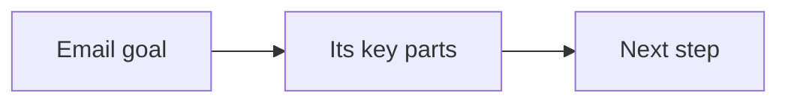

# Email template structures

This guide has one fill-in email for each of the 18 email examples in the
[email example backup](../swipe/EMAIL%20EXAMPLES/). The drafts are new. They use
the source examples' distinct goals and order, not their copy.

There is one extra card with cover art but no email body. It is listed at the
end. It has no template because the source gives no email to model.

The common flow is simple. Each draft adds the parts its goal needs.



## Fill-in templates

### Confirm a call and prepare the reader

**Intent:** Confirm a booked call, ease sales concerns, and collect useful
preparation.

```text
Subject: Your [APPOINTMENT TYPE] is confirmed

Hello [FIRST NAME],

Your [APPOINTMENT TYPE] is set for [DATE AND TIME]. I look forward to speaking with you.

This is a no-pressure conversation to understand [CURRENT SITUATION] and see what would be useful. I have helped [CLIENT TYPE] work through [RELEVANT CHALLENGE], so we can use our time well.

Before we meet, please complete this short worksheet: [WORKSHEET LINK]. It asks about [WORKSHEET TOPIC ONE], [WORKSHEET TOPIC TWO], and [WORKSHEET TOPIC THREE], so I can focus on what matters to you.

We will look at [DISCUSSION AREA ONE], [DISCUSSION AREA TWO], and a clear next step for [DESIRED OUTCOME]. You will leave with useful direction whether or not we work together.

Talk soon,
[YOUR NAME]
```

### Share an expert interview

**Intent:** Use an outside guest or feature to build trust and share useful
ideas.

```text
Subject: A fresh perspective on [TOPIC]

Hello [FIRST NAME],

How do you approach [TOPIC OR CHALLENGE] when [RELEVANT CONDITION]? I sat down with [GUEST ROLE] to explore that question and share practical ideas.

Meet [GUEST NAME], introduced by [THIRD-PARTY SOURCE OR ORGANIZATION] as [CREDIBILITY DETAIL]. Their experience with [AREA OF EXPERIENCE] brings a helpful outside view.

Watch or listen to our conversation here: [INTERVIEW LINK]. We discuss [DISCUSSION POINT ONE], [DISCUSSION POINT TWO], and [USEFUL TAKEAWAY].

Best,
[YOUR NAME]

P.S. You may also like [RELATED RESOURCE ONE], [RELATED RESOURCE TWO], and [RELATED RESOURCE THREE]: [RESOURCE COLLECTION LINK].
```

### Share a collection of interviews

**Intent:** Guide readers through a set of interviews, related links, and a
community.

```text
Subject: A collection of conversations about [TOPIC]

Hello [FIRST NAME],

I gathered these conversations to help you find clear ideas on [TOPIC], without having to search in many places. Start with the section that fits your question.

EXPLORE THE COLLECTION
[COLLECTION LINK]

If you want one place to begin, read [FEATURED GUEST]'s transcript on [FEATURED SUBJECT]: [TRANSCRIPT LINK].

More to explore:
- [GUEST ONE] on [SUBJECT ONE] and [TAKEAWAY ONE].
- [GUEST TWO] on [SUBJECT TWO] and [TAKEAWAY TWO].
- [GUEST THREE] on [SUBJECT THREE], plus [RELATED RESOURCE].

If this collection helps, please share it with [RELEVANT PERSON OR GROUP] or leave a comment about what you want covered next.

Warmly,
[YOUR NAME]

P.S. Join [COMMUNITY NAME] to keep learning with others working on [SHARED GOAL]: [COMMUNITY LINK].
```

### Offer a course as a product bonus

**Intent:** Offer a free learning program tied to trying a product, then show
what it contains.

```text
Subject: A free [PROGRAM TYPE] when you try [PRODUCT]

Hello [FIRST NAME],

When you try [PRODUCT], you can also get [PROGRAM NAME] at no added cost. It is a practical way to learn [SKILL OR OUTCOME] while you put [PRODUCT USE] into action.

Claim your program here: [CLAIM LINK].

[COURSE ASSET COLLAGE DESCRIPTION]

Here is what you will work through:
- [LESSON OR GUIDE ONE] to help you [BENEFIT ONE].
- [WORKSHEET OR TOOL TWO] for planning [BENEFIT TWO].
- [EXAMPLE OR RESOURCE THREE] so you can practice [BENEFIT THREE].
- [BONUS MATERIAL FOUR] to support [BENEFIT FOUR].

We built the course around [BEHIND THE SCENES DESIGN DETAIL], so each part leads into the next and helps you make steady progress.

See the full program details here: [PROGRAM DETAILS LINK].

Enjoy,
[YOUR NAME]
```

### Help finish an order

**Intent:** Find out if something blocked checkout, offer help, and provide the
return link.

```text
Subject: Need help finishing your [PRODUCT] order?

Hello [FIRST NAME],

It looks like you started an order for [PRODUCT] but did not finish checking out. Was anything unclear or did you run into a problem?

Just reply to this email and our team will help with [COMMON QUESTION OR ISSUE].

Your order includes [INCLUDED ITEM ONE], [INCLUDED ITEM TWO], and [SUPPORT OR BONUS], so you have what you need to [CUSTOMER OUTCOME].

You can pick up where you left off here: [CHECKOUT LINK].

Thanks,
The [TEAM NAME] team
```

### Round up useful resources

**Intent:** Give away practical resources and ask readers to use one.

```text
Subject: New free tools for [TOPIC]

Hello [FIRST NAME],

I have been sharing practical help on [TOPIC] because useful ideas should be easy to try before you make a bigger commitment. Here are some recent free resources.

- [RESOURCE ONE]: use it to [USE ONE]. [RESOURCE ONE LINK]
- [RESOURCE TWO]: follow it to [USE TWO]. [RESOURCE TWO LINK]
- [RESOURCE THREE]: try it when you need to [USE THREE]. [RESOURCE THREE LINK]

Choose one that fits your current need and put it into practice today. Small steps can help you see what works for [DESIRED RESULT].

Reply and tell me where you get stuck. I will do my best to point you toward a useful next step.

Best,
[YOUR NAME]
```

### Answer questions and check fit

**Intent:** Answer questions about an offer, list who it suits, and invite a
qualified reader to book.

```text
Subject: Is [OFFER NAME] right for you?

Hello [FIRST NAME],

Here are answers to the questions people often ask about [OFFER NAME].

What is included? [OFFER ANSWER]
Who created it? [CREATOR BACKGROUND]
Why was it made? [REASON]
Is it a fit for me? [FIT ANSWER]
How is it different from [ALTERNATIVE]? [DIFFERENCE]
What does it cost? [PRICE AND PAYMENT DETAILS]
How does the process work? [PROCESS STEPS]
What results can I expect? [PROOF AND LIMITS]
What should I do next? [NEXT STEP]

This may fit you if you:
- [FIT CHECK ONE]
- [FIT CHECK TWO]
- [FIT CHECK THREE]

If those points sound like you, book a conversation here: [BOOKING LINK]. We can talk through your questions and decide together whether to proceed.

Best,
[YOUR NAME]

P.S. [IMPORTANT CONDITIONS, EXCLUSIONS, OR ELIGIBILITY DETAILS].
```

### Send a time-limited sale

**Intent:** Explain a deadline, offer terms, a risk-reducer, and a stack of
included items.

```text
Subject: Save [DISCOUNT] on [OFFER] through [DEADLINE]

Hello [FIRST NAME],

You can get [OFFER] for [DISCOUNT OR PRICE] until [DEADLINE]. See the details and claim your place now: [EARLY OFFER LINK].

I am making this offer because [REASON ONE] and [REASON TWO]. After [PRICE OR ACCESS CHANGE], the offer will [WHAT CHANGES], so this is a good time to decide if it fits.

Watch this short explanation of what is included: [EXPLAINER VIDEO LINK].

You can review the refund terms here: [REFUND TERMS].

With [OFFER], you can [BENEFIT ONE], [BENEFIT TWO], and [BENEFIT THREE]. You also receive:
- [CORE ITEM ONE] — [ITEM VALUE ONE]
- [CORE ITEM TWO] — [ITEM VALUE TWO]
- [BONUS ITEM ONE] — [BONUS VALUE ONE]
- [BONUS ITEM TWO] — [BONUS VALUE TWO]

The listed value is an estimate of the included parts, not a promise of a specific result.

Take a look and decide whether it is right for you: [OFFER LINK].

Best,
[YOUR NAME]

P.S. The offer ends [DEADLINE]. If you need help deciding or have a question, contact us at [SUPPORT PATH].
```

### Invite a qualified reader to a strategy call

**Intent:** Explain a free session, its value, optional next offer, fit, and
preparation.

```text
Subject: A free session to plan your next step

Hello [FIRST NAME],

In a free [SESSION LENGTH] strategy session, we can look at [TOPIC ONE], [TOPIC TWO], and [TOPIC THREE]. You will leave with [PRACTICAL OUTCOME]. There is no charge for this conversation.

Choose a time here: [BOOKING LINK].

I offer these sessions to learn about [AUDIENCE NEED] and help people find a useful direction. If you want more support afterward, you can choose [OPTIONAL FOLLOW-ON SERVICE] with [FOLLOW-ON ITEMS OR SUPPORT] at [FOLLOW-ON PRICE]. That is separate and entirely optional.

There is no pressure to buy anything. We will focus on your situation and what makes sense for you.

Before the call, [PREPARATION STEP]. Please join from [JOINING INSTRUCTIONS] and let us know if your plans change.

This session is likely a fit if you:
- [QUALIFICATION POINT ONE]
- [QUALIFICATION POINT TWO]
- [QUALIFICATION POINT THREE]

If that sounds useful, book your free session here: [BOOKING LINK].

Best,
[YOUR NAME]
```

### Connect a problem to a video and related offer

**Intent:** Name a relatable problem, share a helpful video, ask for feedback,
and add a qualified next offer.

```text
Subject: A short video for [COMMON CHALLENGE]

Hello [FIRST NAME],

Have you ever [RELATABLE SITUATION]? It can be frustrating when [SPECIFIC DIFFICULTY], especially while you are trying to [DESIRED TASK].

I made a short video showing a way to approach it: [VIDEO LINK]. It covers [VIDEO POINT ONE] and [VIDEO POINT TWO].

I hope it gives you a useful place to start. If you watch it, reply and let me know whether it helped or what is still unclear.

Best,
[YOUR NAME]

P.S. If you are working toward [QUALIFYING GOAL] and need help with [RELATED NEED], you can learn about [RELATED PRODUCT] here: [PRODUCT INFORMATION LINK].
```

### Teach a process with a visual template

**Intent:** Present a planning template, show its diagram, give ordered steps,
and explain how to use it.

```text
Subject: Use this template to map [PROCESS]

Hello [FIRST NAME],

The main resource here is a ready-to-use [TEMPLATE TYPE] for planning [PROCESS OR RESULT]. Get your copy: [TEMPLATE LINK].

The process follows this path: [STAGE ONE] → [STAGE TWO] → [STAGE THREE] → [STAGE FOUR]. The diagram shows how each stage leads to the next: [PROCESS DIAGRAM LINK].

Use this checklist as you work through it:
1. [STAGE ONE ACTION] — check that [STAGE ONE CHECK].
2. [STAGE TWO ACTION] — add [STAGE TWO INPUT].
3. [STAGE THREE ACTION] — review [STAGE THREE CHECK].
4. [STAGE FOUR ACTION] — choose [STAGE FOUR NEXT STEP].

Start by filling in [FIRST TEMPLATE SECTION]. Then follow the stages in order, using the video to see how I apply each part: [PROCESS VIDEO LINK].

Best,
[YOUR NAME]
```

### Help a writer use a six-part article

**Intent:** Turn a common writing block into an article, action steps, and a
qualified follow-on offer.

```text
Subject: A six-part guide for getting unstuck

Hello [FIRST NAME],

A blank page can make it hard to begin, even when you know the subject well. I wrote a guide to help you move from a rough idea to a clear piece of writing.

Read the article: [ARTICLE LINK]. It walks through six parts:
1. Choose [GUIDE PART ONE].
2. Define [GUIDE PART TWO].
3. Gather [GUIDE PART THREE].
4. Shape [GUIDE PART FOUR].
5. Write [GUIDE PART FIVE].
6. Review [GUIDE PART SIX].

Pick one piece of writing and apply the first step today. You can use the rest of the guide as you move forward.

A personal note: [PERSONAL EXPERIENCE OR ENCOURAGEMENT].

Best,
[YOUR NAME]

P.S. If you are [QUALIFYING CONDITION] and want support with [RELATED NEED], see [RELATED OFFER]: [OFFER LINK].
```

### Prove results with a campaign walkthrough

**Intent:** Show a campaign video, three measures, context, and who may be a
good partner.

```text
Subject: What this [CAMPAIGN TYPE] campaign achieved

Hello [FIRST NAME],

Here is a walkthrough of how we planned and ran a [CAMPAIGN TYPE] campaign: [CAMPAIGN VIDEO LINK].

The results included [METRIC ONE], [METRIC TWO], and [METRIC THREE]. These measures show [WHAT THE NUMBERS INDICATE].

Rather than focusing only on [VANITY OR EXPECTED MEASURE], compare the results with [BASELINE OR GOAL]. The difference suggests [CAREFUL INTERPRETATION], while [LIMITATION OR CONTEXT] is important to keep in mind.

Best,
[YOUR NAME]

P.S. This approach may suit a partner who [PARTNER FIT]. Learn how we work together here: [PARTNER INFORMATION LINK].
```

### Ask readers to choose a goal

**Intent:** Ask for one reply and use the answers to guide future learning
material.

```text
Subject: What would you like to work on next?

Hello [FIRST NAME],

Which one goal matters most to you right now?

- [GOAL ONE]
- [GOAL TWO]
- [GOAL THREE]
- [GOAL FOUR]

Just reply to this email with the one you choose. A few words about why are welcome, too.

Your answers help me decide what guides, examples, and lessons to make next, so the material can meet you where you are.

Thank you,
[YOUR NAME]
```

### Ask registered guests to attend

**Intent:** Confirm registration, build a two-way commitment, and ask guests
to attend and take part.

```text
Subject: You are registered for [WEBINAR NAME]

Hello [FIRST NAME],

Your place for [WEBINAR NAME] on [DATE AND TIME] is confirmed. Add it to your calendar here: [CALENDAR LINK].

We are both setting aside time for this session. Please reply [ATTENDANCE CONFIRMATION WORD] to let me know you plan to be there.

I will bring [PREPARATION OR MATERIALS] and make the session clear, useful, and focused. There is no pressure to buy or agree with anything; the goal is to help you understand [TOPIC OR OUTCOME].

I will be ready with [SPECIFIC PREPARATION], and you will get the most from joining live, asking questions, and taking part.

Please plan to attend, bring [SUGGESTED MATERIAL], and share your questions in [ENGAGEMENT METHOD].

See you then,
[YOUR NAME]
```

### Help an early leaver catch up

**Intent:** Check for tech trouble, offer the replay and bonus material, explain
the controls, and show attendee feedback.

```text
Subject: Here is the full [WEBINAR NAME] replay

Hello [FIRST NAME],

I noticed you had to leave [WEBINAR NAME] before it ended. Did a technical issue get in the way? I know that can be frustrating, and I hope everything is all right.

You can watch the full replay, including the sections you missed and [BONUS MATERIAL]: [REPLAY LINK].

Use the player controls to pause, rewind, or jump to [SECTION OR TIMESTAMP]. You can also download [RELATED MATERIAL] here: [MATERIAL LINK].

People who joined shared comments such as [ATTENDEE COMMENT ONE] and [ATTENDEE COMMENT TWO]. I hope the replay is useful for you, too.

Best,
[YOUR NAME]
```

### Reach a person who missed a webinar

**Intent:** Acknowledge the missed event, explain the value, and make the free
replay easy to watch.

```text
Subject: You can still watch [WEBINAR NAME]

Hello [FIRST NAME],

Sorry we did not see you at [WEBINAR NAME]. Things come up, so I wanted to make sure you still have access to what we covered.

The session explains [KEY VALUE OR SKILL] and shows how to approach [IMPORTANT CHALLENGE]. Watching it can help you decide what next step makes sense for your situation.

Please take a few minutes to watch the replay here: [REPLAY LINK].

The training is free to watch, and there is no need to sign up for anything else to use the ideas.

Best,
[YOUR NAME]
```

### Recap an offer after a webinar

**Intent:** Thank attendees, list the offer parts and values, give a careful
total-value note, and invite questions.

```text
Subject: Your next steps after [WEBINAR NAME]

Hello [FIRST NAME],

Thank you for joining [WEBINAR NAME] and sharing your time with us. [HUMAN ASIDE ABOUT THE SESSION].

As promised, attendees can access [SPECIAL OFFER] to help you [DESIRED OUTCOME] through [PROCESS OR METHOD].

Your offer includes:
- [ITEM ONE] — [ITEM ONE VALUE]
- [ITEM TWO] — [ITEM TWO VALUE]
- [ITEM THREE] — [ITEM THREE VALUE]
- [BONUS ITEM] — [BONUS VALUE]

Together, these parts have an estimated value of [TOTAL VALUE]. This estimate reflects the listed components; it is not a promise of your individual results.

Review the details and take the next step here: [OFFER CTA LINK].

Best,
[YOUR NAME]

P.S. If you have questions about [OFFER OR FIT], reply to this email or contact [SUPPORT CONTACT].
```

## No email template

### Untitled cover-art card

This card contains cover art, not an email. It has no subject, body, or email
sequence to model. Do not use it as a fill-in template until email content is
found.
