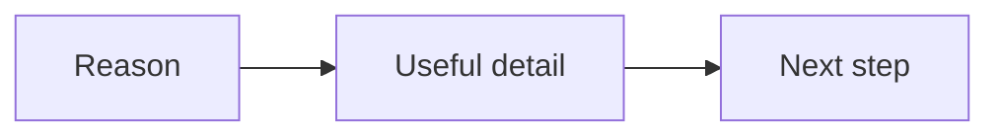

# Email template structures

This guide sums up patterns found in a 19-card email example set. It names the
job each pattern can do and the order of its main parts. It does not copy the
emails. See the [email example backup](../swipe/EMAIL%20EXAMPLES/) for the
original cards and images.

The review found 17 clear patterns and two entries that are not clear enough to
map. These are reusable shapes, not fixed rules.

The email usually moves from a reason to write to a next step.

## Clear patterns

### Confirm a call and help someone prepare

**Intent:** Confirm the meeting and help the person arrive ready.

**Order:** Confirm the time; say what to expect; give any prep task; explain how
to join or get help.

### Share an authority interview

**Intent:** Build trust by sharing an interview or press feature.

**Order:** Name the feature; say who or what it covers; share where to watch or
read it.

### Share an interview collection

**Intent:** Share several interviews and related press items in one email.

**Order:** Explain why the collection is useful; group or link the items; invite
the reader to explore one or more.

### Recover a cart

**Intent:** Help someone return to an order they did not finish.

**Order:** Remind them of the open order; give a way back to the cart; offer help
with a question or problem.

### Round up useful resources

**Intent:** Help readers find useful content in one place.

**Order:** Set up the topic; share each resource with a short cue; invite the
reader to open one.

### Answer product questions

**Intent:** Clear up doubts about a product.

**Order:** Name a question or concern; give a plain answer; explain the next step
for learning more or buying.

### Send a time-limited sale

**Intent:** Tell readers an offer ends at a set time.

**Order:** Name the offer; state the time limit; give the value or terms; link to
act before it ends.

### Invite someone to a strategy call

**Intent:** Ask a reader to book a call about their needs or goals.

**Order:** Name who the call is for; say what the call can help with; invite the
reader to book.

### Link a problem to a resource

**Intent:** Connect a reader's problem with a helpful resource.

**Order:** Name the problem; show why it matters; offer the resource; explain
how to get it.

### Explain a process with video

**Intent:** Make a process easier to grasp with a video.

**Order:** Name the process or question; introduce the video; give the link and
what to look for.

### Share an article or process guide

**Intent:** Teach a process through an article or written guide.

**Order:** Name the topic; say what the guide covers; link to read it.

### Show results as proof

**Intent:** Use a result or example to show what may be possible.

**Order:** Present the result; give context for it; connect it to the reader's
goal; offer a next step.

### Ask an audience question

**Intent:** Start a reply and learn what readers think or need.

**Order:** Ask one clear question; say how to reply.

### Get a webinar attendance commitment

**Intent:** Help people who signed up plan to attend.

**Order:** Remind them of the event; state when and how to join; ask them to
commit or add it to their plans.

### Follow up with someone who left early

**Intent:** Help an attendee who missed part of an event catch up.

**Order:** Note that they left before the end; point to what they missed or a
way to review it; give a next step.

### Follow up with someone who missed an event

**Intent:** Reconnect with a person who did not attend.

**Order:** Acknowledge the missed event; offer a replay or key resource if
available; explain what to do next.

### Recap a webinar offer

**Intent:** Help attendees review an offer made during a webinar.

**Order:** Recall the event; restate the offer and its parts; give the terms or
deadline if known; link to learn more or act.

## Uncertain entries

### Bonus with purchase

**Status:** Uncertain. The entry is named, but its structure is not clear from
the review. No ordered elements are assigned.

### Untitled or unclassified

**Status:** Uncertain. There is no clear title or pattern to classify. Its
intent and order are unknown.
