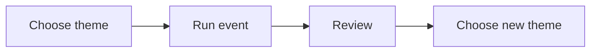

# Next Big Thing program: draft spec

## Goal

Draft the Next Big Thing program as an internal learning program and a reusable
set of public operations guides. The program helps a client promote one new
seasonal theme or one part of their main product or service to warm leads and,
first, to past buyers. Each run should offer a different theme from the last
run.

The program belongs to the Scale Series, which supports growth of the client's
portfolio.

## User-visible behavior

- The internal program index lists Next Big Thing and links to its summary and
  standalone process deck.
- The public operations manual links to a Next Big Thing playbook, recurring
  checklist, and campaign setup SOP.
- The playbook explains when and how to run the program. The checklist helps
  you check one run. The SOP shows you how we prepare and test a campaign
  before invites go out.
- The public guides speak to the client as the reader and source of truth. They
  use “you” for the reader and “we” for our team's role, not instructions about
  what “the client” should do.
- The internal materials guide a learner through the full cycle, including
  delivery, follow-up, review, and choosing a distinct later theme.
- All materials describe repeat purchase and newness as reasons to test this
  approach, not as guaranteed outcomes.

## Non-goals

- Do not publish the internal program summary or deck.
- Do not add the program to public method pages. Public material belongs in the
  operations manual.
- Do not promise sales, repeat purchase, or that new themes always perform
  better.
- Do not define fixed dates, prices, channels, campaign length, or revenue
  targets for every client.
- Do not build the campaign assets, event content, or a client-specific plan.
- Do not name a new public-facing service line or change the Scale Series
  structure beyond this draft.

## Acceptance criteria

- Given a learner opens the internal program index, when they choose Next Big
  Thing, then they can open a linked summary and a standalone deck.
- Given an operator opens the public operations manual, when they look for this
  program, then they can open a linked playbook, checklist, and SOP.
- Given a client reads a public guide, when it describes an action or decision,
  then it speaks directly to the client as “you” or clearly names what “we” do.
  It does not refer to the reader as “the client.”
- Given you use the public guides to run a campaign, when you follow them, then
  the playbook explains the cycle, the checklist covers its checks, and the SOP
  shows how we set up the campaign and test that it is ready.
- Given a learner follows the deck, when they prepare a campaign, then the
  steps cover client fit, theme choice, audience segments, offer and event
  design, campaign preparation, launch, delivery, follow-up, and review.
- Given the client repeats the program, when the next run is planned, then its
  theme is checked against prior runs and is not reused as the same theme.
- Given the team makes a performance claim, when it describes the program, then
  repeat purchase and audience interest are framed as hypotheses to measure,
  not promised results.
- Given the public site is built, when its pages and navigation are checked,
  then the public operations guides are available and the internal summary and
  deck are not copied into the site.
- Given the new Markdown files are reviewed, when links and style are checked,
  then each link resolves, each new idea has a small Mermaid diagram, and the
  text follows repository writing rules.

## Constraints

- Keep learning material under `internal/` and reusable operations guides under
  `docs/ops/`.
- Follow [`AGENTS.md`](../AGENTS.md) and the internal program layout in
  [`program-decks-spec.md`](program-decks-spec.md).
- Keep the deck standalone and readable on phones, tablets, and desktop screens.
- Use plain language and original diagrams. Do not edit `framework-canon/`.
- Preserve unrelated working-tree changes.

## Open questions

- What timing and number of cycles should the Scale Series recommend?
- What campaign and event types best fit this client's market and signature
  solution?
- Which measures should each client use to judge the test?

## Assumptions

- ASSUMPTION: “Pillar program” means an internal learning and delivery program
  following the existing summary-plus-deck pattern.
- ASSUMPTION: “Scale Series” is the engagement track for growing the client's
  portfolio; no existing definition was found, so this draft does not set its
  full structure.
- ASSUMPTION: “All compliant material expected in docs/” means the three
  existing operations manual types: one playbook, one recurring checklist, and
  one repeatable SOP. It does not mean publishing the internal summary or deck.
- ASSUMPTION: The public guides are client-facing source-of-truth material, not
  internal operator instructions. Use “you” for the reader and “we” for our
  team's role.
- ASSUMPTION: Client-facing campaign copy and client-specific plans remain out
  of scope.
- ASSUMPTION: Campaign timing, channels, event format, and measures are chosen
  with each client, not fixed by this program.

## Plan

1. Add the public playbook, checklist, and campaign setup SOP under `docs/ops/`.
2. Link them from the matching section in `docs/ops/index.md` and from the
   matching sections in `mkdocs.yml`.
3. Keep the internal summary and process deck under `internal/programs/`.
4. Verify Markdown links, HTML deck structure, public navigation and build
   output, and writing rules.

Rollback: remove the three public guides and their index rows, remove the
internal summary and deck and their index row, and remove this spec. Do not
change existing program content.

## Diagram

This diagram shows the repeating campaign cycle.

