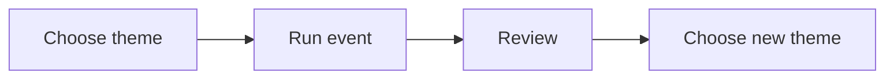

# Next Big Thing program: draft spec

## Goal

Draft an internal learning and delivery program for a recurring seasonal
campaign. The program helps a client promote one new theme or one component of
their signature solution to warm leads and, first, to people who have bought
before. Each run should offer a different theme from the last run.

The program belongs to the Scale Series, which supports growth of the client's
portfolio.

## User-visible behavior

- The internal program index lists Next Big Thing and links to its summary and
  standalone process deck.
- The summary explains who the program helps, why it exists, and what it
  produces.
- The deck guides a learner through choosing a theme, preparing the campaign,
  inviting past buyers and warm leads, delivering the event, reviewing results,
  and choosing a distinct theme for a later run.
- The materials describe repeat purchase and newness as reasons to test this
  approach, not as guaranteed outcomes.

## Non-goals

- Do not publish the program or add it to public site navigation.
- Do not promise sales, repeat purchase, or that new themes always perform
  better.
- Do not define fixed dates, prices, channels, campaign length, or revenue
  targets for every client.
- Do not build the campaign assets, event content, or client-specific plan.
- Do not name a new public-facing service line or change the Scale Series
  structure beyond this draft.

## Acceptance criteria

- Given a learner opens the internal program index, when they choose Next Big
  Thing, then they can open a linked summary and a standalone deck.
- Given a learner follows the deck, when they prepare a campaign, then the
  steps cover client fit, theme choice, audience segments, offer and event
  design, campaign preparation, launch, delivery, follow-up, and review.
- Given the client repeats the program, when the next run is planned, then its
  theme is checked against prior runs and is not reused as the same theme.
- Given the team makes a performance claim, when it describes the program, then
  repeat purchase and audience interest are framed as hypotheses to measure,
  not promised results.
- Given the program pages are added, when the public site is built, then these
  internal pages and the deck are not exposed through public navigation or
  copied into the site.
- Given the new Markdown files are reviewed, when links and style are checked,
  then each link resolves, each new idea has a small Mermaid diagram, and the
  text follows repository writing rules.

## Constraints

- Keep all new program material under `internal/`.
- Follow [`AGENTS.md`](../AGENTS.md) and the internal program layout in
  [`program-decks-spec.md`](program-decks-spec.md).
- Keep the deck standalone and readable on phones, tablets, and desktop screens.
- Use plain language and original diagrams. Do not edit `framework-canon/`.
- Preserve unrelated working-tree changes.

## Open questions

- What timing and number of cycles should the Scale Series recommend?
- What campaign and event types best fit this client's market and signature
  solution?
- Which measures should each client use to judge the test?

## Assumptions

- ASSUMPTION: “Pillar program” means an internal learning and delivery program
  following the existing summary-plus-deck pattern.
- ASSUMPTION: “Scale Series” is the engagement track for growing the client's
  portfolio; no existing definition was found, so this draft does not set its
  full structure.
- ASSUMPTION: The first draft belongs only in internal materials. Public
  publication needs a separate review.
- ASSUMPTION: Campaign timing, channels, event format, and measures are chosen
  with each client, not fixed by this program.

## Plan

1. Add the Next Big Thing summary and standalone process deck under
   `internal/programs/`.
2. Add the program to `internal/programs/index.md`.
3. Verify Markdown links, HTML deck structure, public build exclusion, and
   writing rules.

Rollback: remove the new summary and deck, remove the index row, and remove this
spec. Do not change existing program content or the public site.

## Diagram

This diagram shows the repeating campaign cycle.

