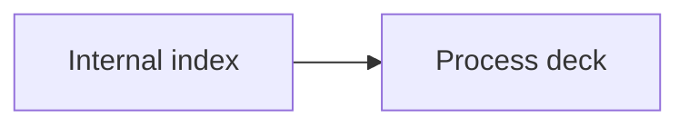

# Program learning material: internal scope

## Goal

Keep the learning-program insight and its detailed learning material in the
internal repo. Do not expose a Learning programs section or its pages in the
published site navigation. The material should guide a learner through a full
program from first action to the program's end result.

## Audience and size

Write for a new learner. Use clear steps, simple examples, and short practice
tasks. Keep material under `internal/`; do not publish it through MkDocs.

## Program layout

Move the 48 files in `12 Week Launch Accelerator/` into the existing
`High Ticket Launch Accelerator/` folder. Keep the three files already there.
The combined folder has 51 files and gets one page and one deck. The other eight
folders each get one page and one deck.

## Internal output

- Keep one standalone Reveal.js HTML deck for each of the nine programs under
  `internal/programs/`.
- Keep an internal index that links to each program's deck.
- Remove the programs section from MkDocs navigation and remove old public
  program pages and decks from `docs/programs/`.

Each deck must be a thorough, comprehensive, sequential process map. Show the
actions from the start state through each decision, task, check, and handoff to
the clear end result of that program. Include prerequisites, inputs, outputs,
responsible roles, completion checks, and recovery steps where useful. Do not
replace the process with a short overview or a distilled list of concepts.
Build each program's map from its matching source material in
`framework-canon/`. Read the source lessons for that program before writing its
steps. Do not use another program's generic workflow as a substitute. Keep
source files read-only, paraphrase all content, and do not name people or quote
the source.

## Writing and source rules

- Do not copy source text or use direct quotes.
- Do not name people from the source files.
- Do not use the forbidden brand name. Use plain, generic terms.
- Keep source mapping and internal gaps inside `internal/` only.
- Use simple words and short sentences. Define a new term the first time it
  appears.
- Treat sample metrics as practice targets, not promises.

## Design and access

- Use a pinned Reveal.js release and the viewport-native layout in the Reveal.js
  skill.
- Keep text readable on phones, tablets, and desktop screens.
- Use only original CSS diagrams and shapes. Do not add images copied from the
  source files.
- Provide slide numbers, progress, keyboard controls, and touch navigation.

## Verification

- Confirm the merged folder has 51 files and the old folder is gone.
- Confirm the other eight source folders are unchanged.
- Confirm no Learning programs section appears in MkDocs navigation.
- Confirm internal index and all nine decks exist and link correctly.
- Confirm each deck presents an ordered process from start to end result, not
  just a high-level summary.
- Scan new public files for forbidden names, person names, session references,
  and copied source phrases.
- Run `uv run mkdocs build --strict`.
- Confirm no program deck is copied into `site/`.
- Check every slide for overflow at phone portrait, phone landscape, and desktop
  sizes.

## Scope

- Build the local MkDocs site only. There is no live deploy step in this work.
- Preserve unrelated working-tree changes.
- Keep `framework-canon/` ignored and untracked.

## Diagram

The internal index opens its matching deck. The public site has no programs menu.

## Ordered plan

1. Update MkDocs navigation to remove the programs section.
2. Move the index and nine decks from `docs/programs/` to `internal/programs/`.
3. Expand each deck into a sequential start-to-finish process map.
4. Update this spec and internal links to describe the internal-only material.
5. Build MkDocs and check navigation, links, deck counts, and output exclusion.

Rollback: restore the prior navigation and move the files back from
`internal/programs/` to `docs/programs/` using version control.

## Acceptance criteria

- Given a visitor opens the published site, when they view its navigation, then
  no Learning programs menu or program page is exposed.
- Given a team member opens the internal program index, when they choose a
  program, then its full deck is available in the internal repo.
- Given a learner follows any deck, when they complete its steps in order, then
  the deck leads from stated prerequisites to a defined program result with
  actions, decisions, checks, and handoffs made clear.
- Given a deck is reviewed beside the matching source lessons, when its process
  is checked, then its ordered steps reflect that program's own material rather
  than a generic repeated process.
- Given MkDocs builds the site, when output is checked, then no program deck is
  copied into `site/`.

ASSUMPTION: “the internal repo path” means `internal/programs/` in this repo.
ASSUMPTION: “the training program” refers to all nine current learning programs,
not one selected program. Source files in `framework-canon/` are the authority
for tailoring each program's process.
