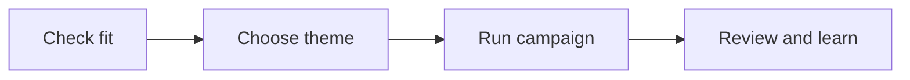

# Next Big Thing

Next Big Thing is part of the Scale Series, the group of programs that help a
client grow its portfolio. It helps a client grow their portfolio with a
recurring seasonal campaign. Each run focuses on a new theme or one part of the
client's main product or service.

## Who it helps

It helps a client with past buyers and warm leads (people who have shown
interest but have not bought) who may care about a fresh theme. The client and
team choose the campaign timing, event type, offer, channels, and measures to
fit the business.

## Why it exists

A useful new theme may give past buyers a reason to consider buying again.
Something new may also draw interest from warm leads. These are ideas to test,
not promised results. Each run gives the team a chance to learn what the
audience responds to.

## What it produces

- A checked theme that differs from past runs.
- A clear audience plan, event, offer, and campaign schedule.
- Ready messaging and assets, plus an event plan.
- A follow-up and results review.
- A record of learning and a distinct theme to consider next.

The campaign follows this loop.

## Start the program

[Open the Next Big Thing process deck](next-big-thing.html)

## Where to go next

- Use the [Webinar playbook](../../docs/ops/playbooks/webinar.md) and [Webinar run of show checklist](../../docs/ops/checklists/webinar-run-of-show.md) if the chosen event is a webinar.
- Use the [Email and nurture playbook](../../docs/ops/playbooks/email-nurture.md) when email is part of the campaign.
- Use the [Launch calendar checklist](../../docs/ops/checklists/launch-calendar.md) when its launch steps fit the agreed plan.
